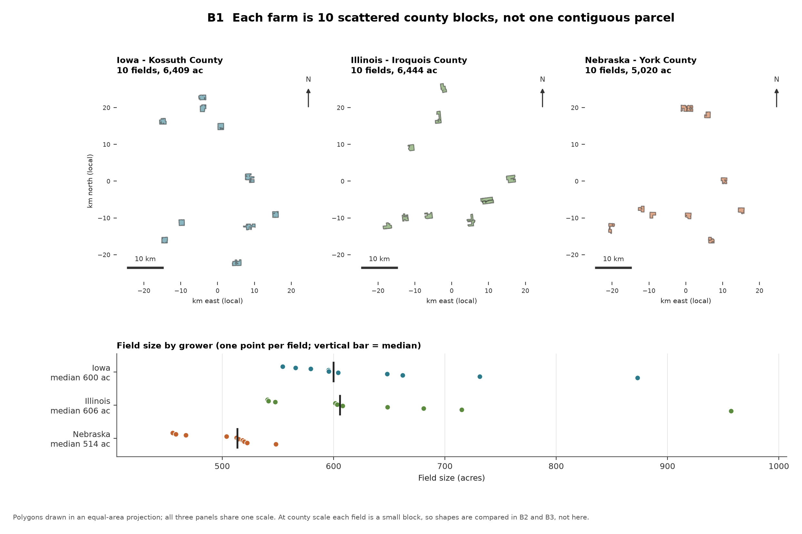
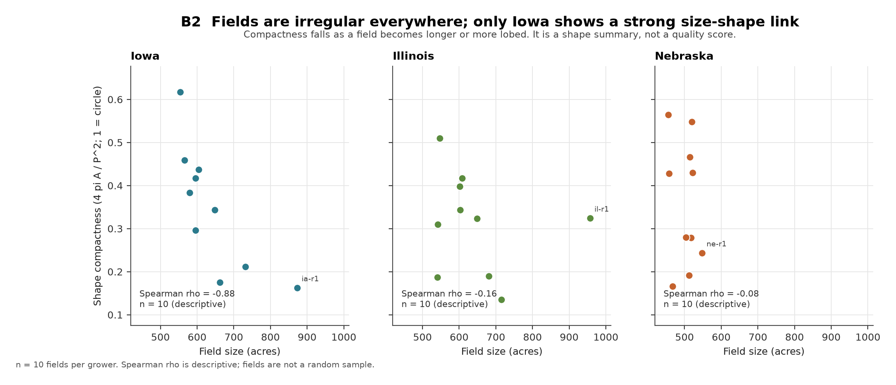
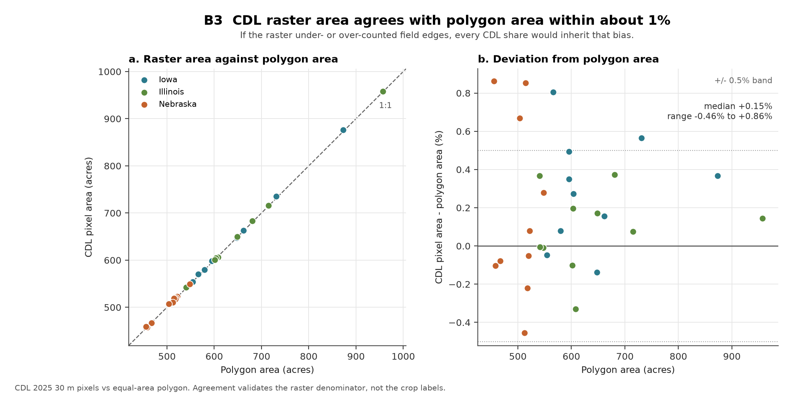
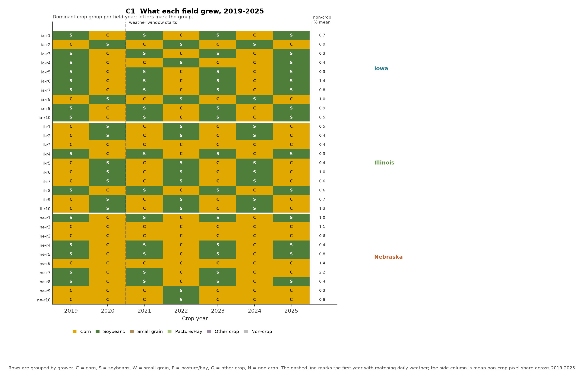
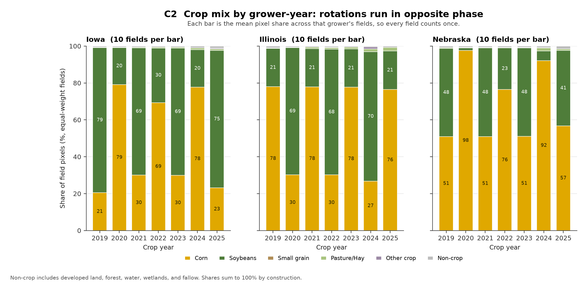
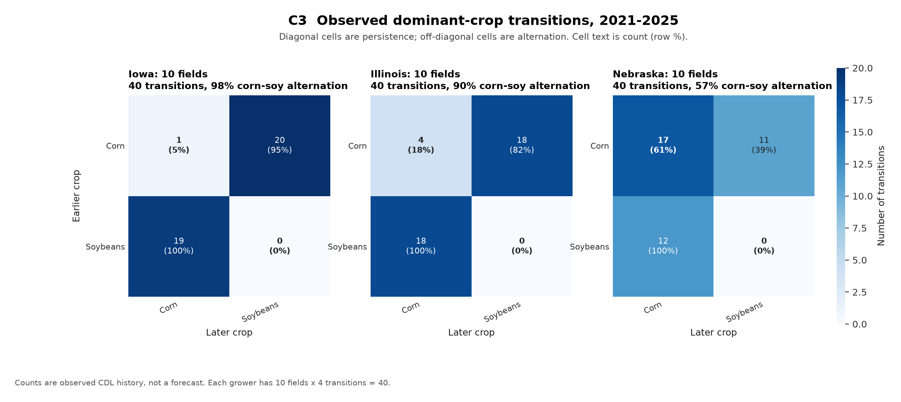
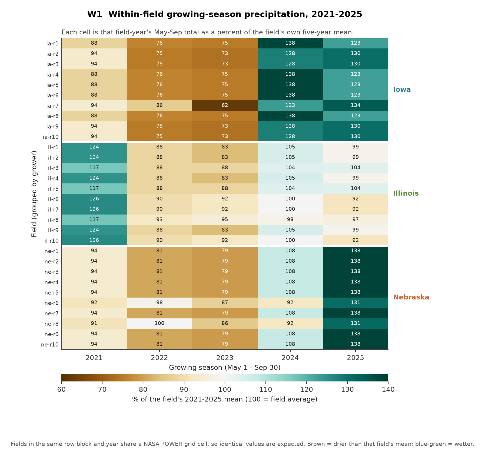
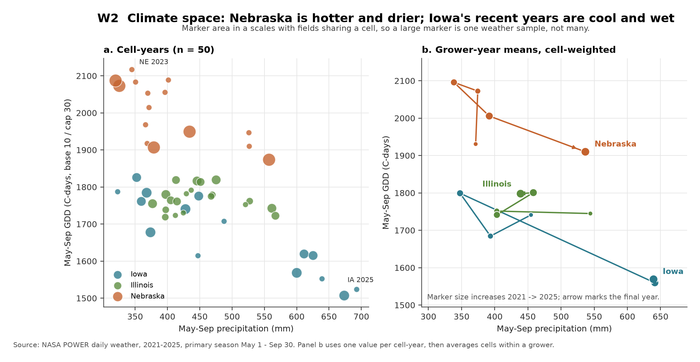
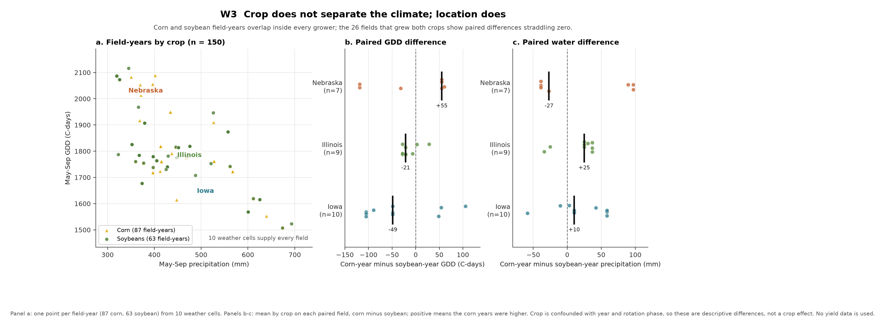

# Field-level EDA: boundaries, CDL, and weather

**Question.** Are these 30 fields one comparable population, or several distinct operating
contexts?

**Short answer.** Three operating contexts. Field geometry is broadly interchangeable, but
rotation discipline, crop mix, and heat/water exposure separate Iowa, Illinois, and
Nebraska. Crop choice tracks geography and rotation phase rather than a separate weather
niche.

This report summarizes a static EDA run. It computes nothing new. Generated from
`2026-11-25T01:00:34+00:00`; CDL years 2019–2025, weather years
2021–2025.

## Scope and data

- 3 growers x 10 fields = 30 fields, 5 weather years, one farm per grower.
- Categories: field boundaries, CDL crop history, and May–Sep growing-season weather.
- Weather is NASA POWER on 10 native grid cells, so field counts overstate
  independent weather samples.
- Not a random sample: the fields are the 10 largest CSB blocks per county.
- No yield, soil, irrigation, NDVI, or management data is used. No p-values are presented
  as inference.

## Headline numbers

- Field size: 455–957 acres, median
  573. Compactness 0.14–0.62.
- Weather: 10 cells. GDD ranks Iowa < Illinois < Nebraska under every
  definition tested; precipitation does not, so only "Nebraska is driest" survives.
- Rotation: alternation is near-strict in Iowa and Illinois and weaker in Nebraska, where
  repeated corn is common.
- Crop-weather: 87 corn field-years and 63 soybean
  field-years. The 26 fields that grew both crops show paired
  differences that do not point one way across growers.

## 1. Boundaries

The "farm" is a portfolio of scattered county blocks, not one contiguous parcel. The map
and acreage strip show the size range; the correlation strip asks whether size predicts
shape; the parity panel checks that CDL pixel area can be used as a composition denominator.

| Grower | Fields | Min ac | Median ac | Max ac | Area–compactness rho |
|---|---:|---:|---:|---:|---:|
| Iowa | 10 | 554 | 600 | 873 | -0.88 |
| Illinois | 10 | 541 | 606 | 957 | -0.16 |
| Nebraska | 10 | 455 | 514 | 548 | -0.08 |

Polygon versus CDL area: median deviation +0.15%,
largest absolute deviation 0.86%. CDL area is credible as a
denominator.

### B1  Static geospatial map by grower, plus the acreage distribution behind it.



### B2  Correlation between field size and compactness within each grower.



### B3  Polygon area versus CDL pixel area, the composition denominator check.




## 2. CDL crop history

Corn and soybean dominate every grower. The interesting difference is discipline: Iowa and
Illinois alternate, Nebraska repeats corn more often.

| Grower | Fields | Mean alternation | Continuous-corn fields | Fields with 2+ crops |
|---|---:|---:|---:|---:|
| Iowa | 10 | 98% | 1 | 10 |
| Illinois | 10 | 90% | 1 | 9 |
| Nebraska | 10 | 57% | 6 | 7 |

Dominant-crop field-years, 2019–2025:

| Grower | Corn | Soybeans |
|---|---:|---:|
| Iowa | 33 | 37 |
| Illinois | 41 | 29 |
| Nebraska | 49 | 21 |

### C1  Observed crop sequence per field and the rotation archetypes.



### C2  Crop mix by grower-year and whether rotations are synchronized.



### C3  Observed crop transitions, the rotation-discipline comparison.




## 3. Weather

Weather is compared at the honest unit: cell-year for growers, field-year for within-field
change. Cell-weighted grower means:

| Grower | Cells | May–Sep precip (mm) | GDD (C-days) | Heat days >= 35 C |
|---|---:|---:|---:|---:|
| Iowa | 3 | 495 | 1,671 | 5.4 |
| Illinois | 4 | 450 | 1,767 | 1.1 |
| Nebraska | 3 | 403 | 2,003 | 21.9 |

Iowa is the coolest and wettest of the three; Nebraska is the hottest, driest, and has the
most heat days. Precipitation ordering between Iowa and Illinois is season-sensitive, so the
report does not claim one is wetter. GDD ordering is stable across the alternate definitions.

### W1  Each field-year's wet/dry position relative to that field's own mean.



### W2  Grower climate space at the honest cell-year unit.



### W3  Corn versus soybean exposure, and whether location separates them.




## 4. Crop-weather synthesis

Corn and soybean occupy the same climate inside each grower. The paired comparison below
uses only fields that grew both crops, so location is held still; the difference still
carries year-to-year weather.

| Grower | Paired fields | Median corn − soy GDD | Median corn − soy precip (mm) |
|---|---:|---:|---:|
| Iowa | 10 | -49 | +10 |
| Illinois | 9 | -21 | +25 |
| Nebraska | 7 | +55 | -27 |

The medians do not share a sign across growers. That is the finding: crop choice is not a
clean weather-sorting mechanism here. Location and rotation phase are.

## Assignment coverage

| Requirement | Artifacts |
|---|---|
| Statistical visualization, boundaries | B1 acreage strip, B2 area vs compactness |
| Comparison / correlation, boundaries | B3 polygon vs CDL area |
| Statistical visualization, CDL | C1 crop sequence, C3 transitions |
| Comparison / correlation, CDL | C2 crop mix by grower-year |
| Statistical visualization, weather | W1 within-field anomaly, W3 exposure panels |
| Comparison / correlation, weather | W2 grower climate space (W3 paired differences support the synthesis) |
| Geospatial map | B1 field boundary map by grower |
| Levels covered | field, field-year, grower, across-grower |

## Limits

- Fields are the largest CSB blocks per county, not a random sample; treat group differences as descriptions of these three cases.
- Weather is sampled on a small number of grid cells. Fields sharing a cell have identical daily series, so field counts overstate independent weather samples.
- Season-definition sensitivity is reported in weather_sensitivity.csv; a precipitation ranking may change between May-Sep and Apr-Oct.
- CDL composition includes non-crop classes so shares sum to about 100%; crop-only share must be computed by filtering, not from a residual.
- Crop-weather differences pair corn years with soybean years on the same field, so they also carry year-to-year weather; they are not a crop effect.
- No yield data is used. Weather exposure is not yield, and no yield claim is made.
- Crop transitions describe observed CDL history only. No next-crop prediction is made.
- No p-values or causal claims. Co-occurrence is not causation.

## Artifact index

| Kind | ID | Category | Level | File | Job |
|---|---|---|---|---|---|
| figure | B1 | Boundaries | across fields / map | `figures/b1_field_map_and_acreage.png` | Static geospatial map by grower, plus the acreage distribution behind it. |
| figure | B2 | Boundaries | across fields | `figures/b2_area_vs_compactness.png` | Correlation between field size and compactness within each grower. |
| figure | B3 | Boundaries | comparison | `figures/b3_polygon_vs_cdl_area.png` | Polygon area versus CDL pixel area, the composition denominator check. |
| figure | C1 | CDL | within field / field-year | `figures/c1_crop_sequence_heatmap.png` | Observed crop sequence per field and the rotation archetypes. |
| figure | C2 | CDL | grower / across growers | `figures/c2_crop_mix_by_grower_year.png` | Crop mix by grower-year and whether rotations are synchronized. |
| figure | C3 | CDL | comparison | `figures/c3_transition_matrix.png` | Observed crop transitions, the rotation-discipline comparison. |
| figure | W1 | Weather | within field / field-year | `figures/w1_within_field_precip_anomaly.png` | Each field-year's wet/dry position relative to that field's own mean. |
| figure | W2 | Weather | grower / across growers | `figures/w2_climate_space.png` | Grower climate space at the honest cell-year unit. |
| figure | W3 | Weather | within field / across growers | `figures/w3_crop_weather_exposure.png` | Corn versus soybean exposure, and whether location separates them. |
| table |  | Boundaries |  | `tables/field_summary.csv` | Field geometry, acreage, compactness, CDL area check. |
| table |  | CDL |  | `tables/cdl_field_year.csv` | Crop-group shares and dominant crop per field-year. |
| table |  | CDL |  | `tables/rotation_summary.csv` | Sequence, transitions, change rate, diversity. |
| table |  | Weather |  | `tables/weather_field_year.csv` | Primary season and sensitivity columns per field-year. |
| table |  | Weather |  | `tables/weather_cell_year.csv` | De-duplicated weather per grid cell-year. |
| table |  | Weather |  | `tables/crop_weather.csv` | Field-year weather joined to the CDL dominant crop. |
| table |  | Weather |  | `tables/weather_qc.csv` | Per field-year completeness and range checks. |
| table |  | Weather |  | `tables/weather_sensitivity.csv` | Alternate season and GDD definitions with ranks. |
| table |  | All |  | `tables/grower_profile.csv` | One row per grower; the report handoff table. |

## Reproduce

```bash
export DATA_PIPELINE_DATA_ROOT=~/my-farm-advisor-runtime
cd my-farm-advisor/eda/field-eda/src
"${DATA_PIPELINE_DATA_ROOT}/data-pipeline/.venv/bin/python" run_field_eda.py \
  --out "${DATA_PIPELINE_DATA_ROOT}/data-pipeline/eda/field-eda"
cd ../examples/analysis-report
"${DATA_PIPELINE_DATA_ROOT}/data-pipeline/.venv/bin/python" run_report.py
```

The report step is a one-time consumer. The reusable workflow ends at tables, figures, and
the manifest.
